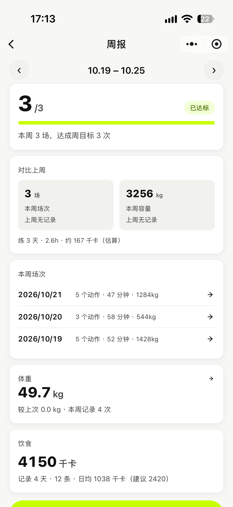
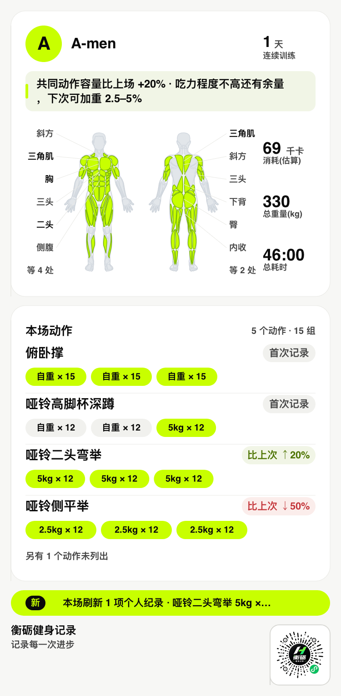
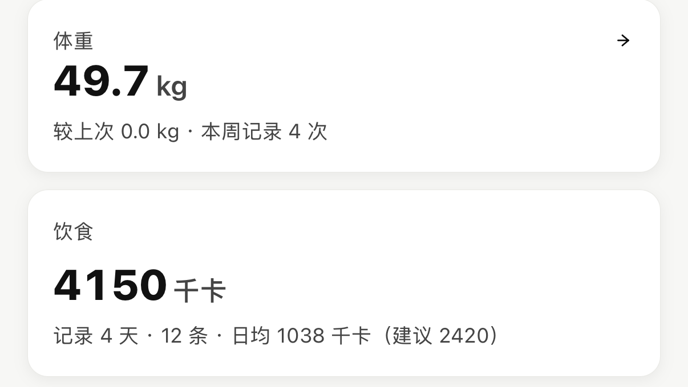
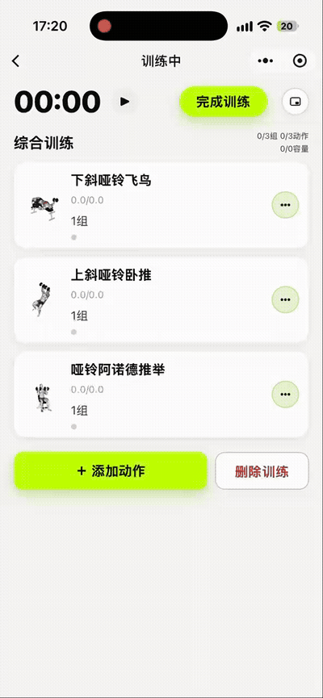

> 记录的价值，在你回看的那一周才兑现。

大家好，我是 衡砺健身记录。距上一篇介绍过去了一个月，我的健身小程序**衡砺健身记录**更新到了 **1.1.0**——这一版只围绕一个主题：让练完的人，看得见自己的这一周。

之前的版本解决了「记下来」：吃了什么、练了哪几组、身体什么状态。但记录散落在每一天里，缺一个「周」的视角——这一周练了几次、比上周勤了还是懒了、有没有刷新纪录，得自己翻。

1.1.0 把这些收进了一张周报。往下过一遍这次更新的重点。

## 01 本周周报：练完看得见

入口在「我的」页「我的训练」卡右上角的**「本周周报」**。点进去，就是你这周训练的全貌。

**达成度：目标就在眼前。** 本周练了几场、目标几次、进度条走到哪，进页面一眼看完。周目标来自你的训练计划，没定计划也可以在设置里自定每周几次。下面还会配一句评语——差几次达标、还剩几天，都替你算好。

**对比上周：升降一目了然。** 场次和训练容量都会和上周比。一点小心思：小幅波动按「持平」算，不制造焦虑——训练状态本来就有起伏，看趋势就好。

**本周亮点：真 PR 才挂标。** 刷新了**个人纪录（PR）**的动作会出现在这里。判定按诚实口径：严格超过此前全部历史最高才算，第一次练的动作不叫破纪录——挂上去的每一条，都货真价实。

**场次直达：点一下回到那天。** 本周每一场训练都列在周报底部，点任意一场，直接跳到那天的训练复盘——练了什么、容量多少、肌群状态，当时的样子都在。左上角箭头还能翻到之前的任意一周，每一周都有独立周报。

练得好的一周，值得被看见。点「生成周报分享卡」，会按你这周的数据自动挑版式——空周、有对比、有 PR，各有各的样子；生成后可以直接发给微信好友，或保存到相册发朋友圈。

一个小设计：卡片右下角带着小程序码，朋友扫一扫就能直达——你分享出去的不是一张截图，而是一个随身的入口。

*分享卡样式（训练复盘版式，右下角自带小程序码）*

## 02 体重与饮食：一周一瞥

周报页往下翻，新增了两张卡：体重与饮食。练和吃，在同一页看完一周。

**体重：变化如实说。** 本周最新一次体重、比上次变化多少，直接给出。如果基线在上一周，也一样如实计算——跨周的变化不算意外，算进度。本周还没上秤？会显示最近一次记录提醒你。点卡片直达体重记录页。

**饮食：日均对着建议看。** 这一周记了多少餐、总共多少千卡、日均多少，旁边附上按你身体数据算出的建议摄入——对一眼，就知道吃多了还是吃少了。数据都来自你平时的随手记录，不用额外填什么。

> 单日波动是噪声，一周的趋势才是信号。

## 03 练中加动作：训练不中断

练到一半想加个动作、或者某个动作今天状态不对想换一个——之前要在小弹窗里翻来翻去，1.1.0 把这条路改直了：**直接去动作库挑**。

1. 训练中点「添加/替换」，随时可用；
2. 跳到动作库挑选，1300+ 动作照常筛选；
3. 选完自动带回训练页，进度与计时不受影响。

替换动作时，已练完的组数会原样保留。挑动作时页面上会挂着一条绿色提示横幅，告诉你正在挑选模式——不想加了点一下就取消，不会误触。

*训练中途跳动作库挑选，选完自动带回*

## 写在最后

1.1.0 正在陆续覆盖，重新打开小程序就是新版。老规矩：没有会员、没有广告、不用注册，所有记录只存在你自己的手机里。

在微信里搜索「**衡砺健身记录**」，或者扫描下面的小程序码，直接开练。

用下来有任何想吐槽或想要的功能，欢迎留言——独立开发，反馈就是最快的迭代。下周的周报，希望是满格的那种。

我是 衡砺健身记录，衡砺健身记录的开发者，热衷于把健身工具做得更轻更干净。

如果你觉得今天这篇有收获，欢迎**点赞、在看、转发**三连，我们下篇见。
