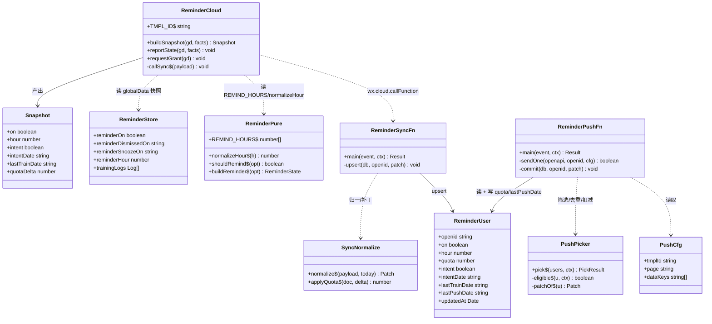
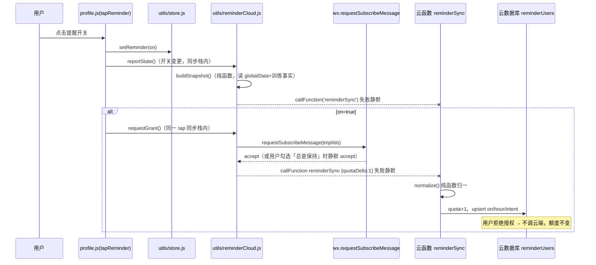
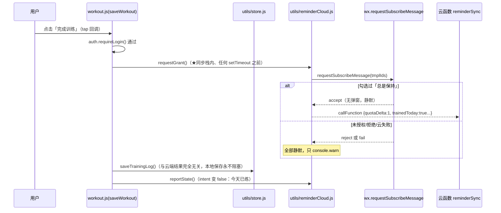
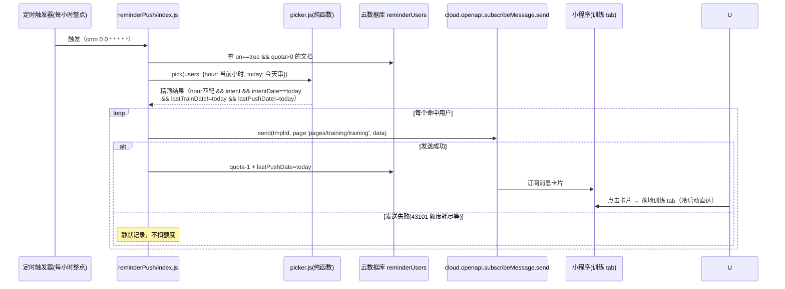
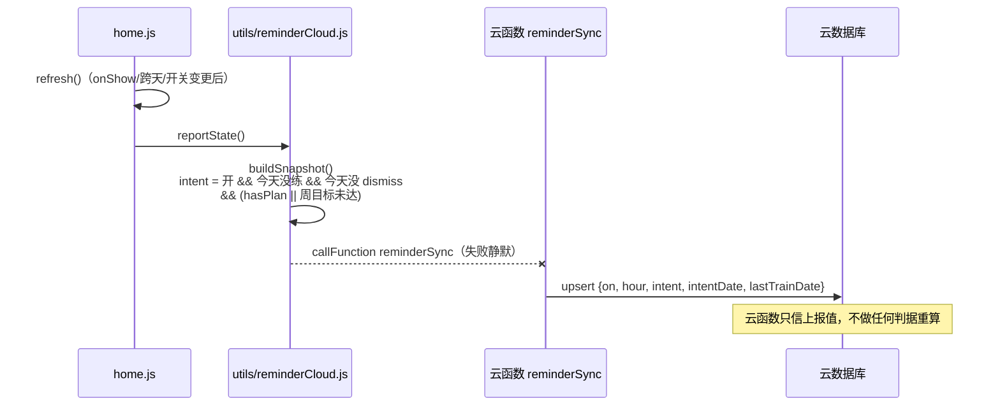
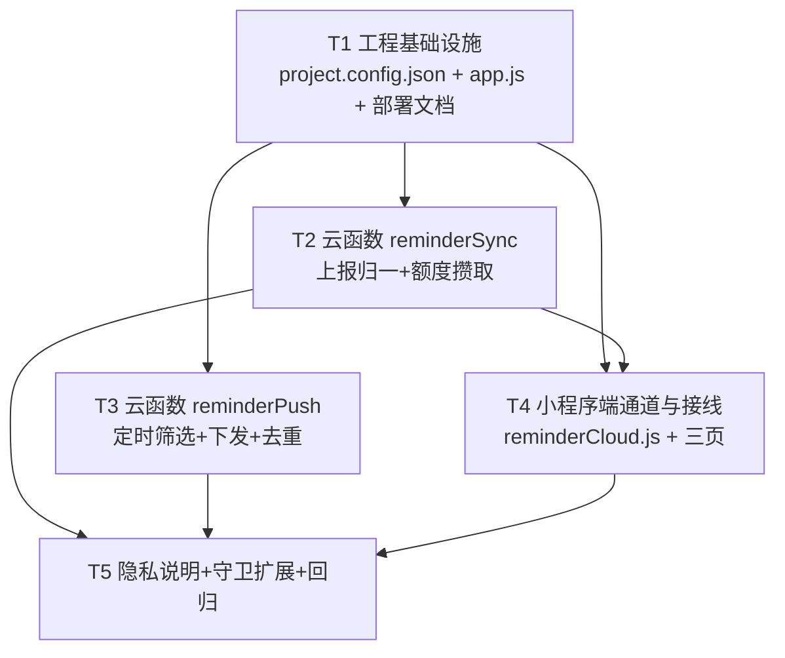

# 衡砺健身记录 · 订阅消息提醒（P0 闭环）系统设计

> 架构师：高见远 ｜ 输入：PRD + 已拍板决策 ①–⑤ ｜ 技术栈已定：原生 WXML/JS 小程序 + 微信云开发（环境 `cloud1-d0g5ihto42b4ed256`）

---

## Part A 系统设计

### 1. 实现思路

**核心难点与对策**

| 难点 | 对策 |
|---|---|
| 订阅授权必须由用户点击同步触发，且「总是保持」用户要静默续额度 | 授权调用收拢到 `utils/reminderCloud.js` 单一入口，两处接线（profile 的 `tapReminder`、workout 的 `saveWorkout`）都保持在 **tap 回调同步栈内** 调用（`saveWorkout` 中置于所有 `setTimeout` 之前），fire-and-forget，不阻塞保存 |
| 两套提醒判据会漂移 | **决策②落地**：站内 `utils/reminder.js` 是唯一真源。客户端只上报「事实快照」（开关 / 档位 / 当日意图 / 最近训练日），云函数不重算任何判据，只按上报值筛选 |
| 云不可用不能影响本地功能 | `utils/reminderCloud.js` 全部出口 try/catch + fail 静默（`console.warn`），任何云端失败不 throw、不 toast 报错、不阻塞训练与提醒条 |
| 云函数要能被 node 守卫直测 | 业务逻辑（上报归一 / 筛选 / 去重 / 额度扣减）全部抽成**纯函数模块**（不 require `wx-server-sdk`），`wx-server-sdk` 调用只存在于各云函数的 `index.js` 薄壳 |
| tabBar 页回跳兼容 | 订阅消息 `page` 字段填 `pages/training/training`（tabBar 页）。兼容写法：卡片点击由微信冷启动进入该 tab 页，训练 tab 页 `onLoad/onShow` 本就无参数依赖，无需中转页；若线上实测个别版本跳转异常，预留备选方案（见「待明确事项」） |
| 主包体积红线 | `cloudfunctions/` 目录在 `project.config.json` 的 `packOptions.ignore` 补 folder 规则（双保险） |

**架构模式**：本地优先 + 云端薄档案。

- 小程序端：既有单例 `store` + 纯函数工具层不变；新增 `utils/reminderCloud.js` 作为**唯一的云端通道**（快照上报 + 授权攒额度），页面只接线不写云逻辑。
- 云端：两个云函数各一薄壳 + 各一纯函数模块
  - `reminderSync`（客户端 `wx.cloud.callFunction` 调用）：归一上报快照 → upsert `reminderUsers`；
  - `reminderPush`（定时触发器每小时整点）：按当前小时筛选 → 逐个 `subscribeMessage.send` → 扣额度 → 写 `lastPushDate` 去重。

**数据库集合 `reminderUsers`**（每用户一文档，`_openid` 由云开发自动写入，无需客户端传 openid）：

| 字段 | 类型 | 说明 |
|---|---|---|
| `on` | boolean | 提醒开关（关=仅停用，额度保留，决策③） |
| `hour` | number | 档位 18/19/20/21（合法性由客户端 `reminder.normalizeHour` 保证，云函数侧再兜底） |
| `quota` | number | 剩余可下发次数（授权 accept 时 +1，下发 -1，耗尽自然失效，决策④） |
| `intent` | boolean | **当日**是否有提醒意图（客户端算，唯一真源） |
| `intentDate` | string | intent 所属日期 `'YYYY-MM-DD'`（跨天自动失效，云函数比对 `intentDate === today`） |
| `lastTrainDate` | string | 最近一次训练日期（客户端上报 `trainedToday` 时刷新为今天） |
| `lastPushDate` | string | 最近一次成功下发日期（同用户同日去重） |
| `updatedAt` | Date | 云函数侧 `db.serverDate()` |

客户端**不传 openid**，云端 `cloud.getWXContext().OPENID` 取。

### 2. 文件列表（相对路径）

```
project.config.json                                   [改] cloudfunctionRoot + packOptions.ignore 补 cloudfunctions
app.js                                                [改] globalData 补 reminderTmplId 占位常量（注释：模板 ID 在公众平台申请后替换）
utils/reminderCloud.js                                [新] 云端唯一通道：快照计算(纯函数) + 授权封装 + 上报封装(失败静默)
pages/profile/profile.js                              [改] tapReminder 接授权+上报；onPickReminderHour 接上报
pages/workout/workout.js                              [改] saveWorkout 挂静默续额度（同步栈内）
pages/home/home.js                                    [改] refresh() 末尾上报快照；tapDismiss/tapSnooze 后上报 intent=false
cloudfunctions/reminderSync/index.js                  [新] 薄壳：getWXContext → 归一 → upsert reminderUsers
cloudfunctions/reminderSync/normalize.js              [新] 纯函数：payload 校验/归一 + upsert 补丁计算（含 quota 增量）
cloudfunctions/reminderSync/package.json              [新] wx-server-sdk 依赖声明
cloudfunctions/reminderPush/index.js                  [新] 薄壳：查库 → picker.pick → 逐个 send → 扣额度/写 lastPushDate
cloudfunctions/reminderPush/picker.js                 [新] 纯函数：筛选/去重/额度扣减决策（node 直测）
cloudfunctions/reminderPush/package.json              [新] wx-server-sdk 依赖声明
cloudfunctions/reminderPush/config.json               [新] 定时触发器（每小时整点 cron: 0 0 * * * * *）
pages/privacy/privacy.wxml                            [改] 新增「提醒推送云端数据说明」段
scripts/verify-reminder-cloud.cjs                     [新] 云端纯函数守卫 + 小程序端接线断言（node 直跑）
scripts/verify-profile.cjs                            [改] C10 禁词扫描扩展到 privacy.wxml
docs/deploy-reminder.md                               [新] 云函数部署说明 + 模板字段申请建议 + 模板 ID 填写步骤
```

### 3. 数据结构与接口



### 4. 程序调用流程

**流程一：开关开启 → 授权攒额度（profile 页，用户点击触发）**



**流程二：完成训练 → 静默续额度（workout 页）**



**流程三：整点定时下发（云函数 reminderPush）**



**流程四：首页快照上报（决策②的核心通路）**



### 5. 待明确事项（需主理人/用户拍板）

1. **模板 ID 与字段**：需用户在公众平台「订阅消息 → 公共模板库」申请。建议选「健身打卡提醒/运动提醒」类目，字段建议：`thing1`=提醒文案（≤20 字）、`time2`=提醒时间、`thing3`或`date3`=状态副语（如「本周还差 1 天」）。申请完成前 `TMPL_ID` 留空，空值时客户端不弹授权、云函数不下发（安全空转）。
2. **时区口径**：云函数默认运行在 UTC+8（与客户端一致），`reminderPush` 内 `new Date().getHours()` 直取当前小时；若线上实测时区漂移需改为显式 `+8h` 偏移——按当前微信云开发实现不预期发生，但部署后要实测一次 18 点档。
3. **tabBar 落地页实测**：`page: 'pages/training/training'` 在主流基础库可用（冷启动直达 tab）。若实测个别版本出现点击卡片无法打开，备选方案是新增非 tab 中转页（本设计暂不建，避免无用页面进包）。
4. **授权弹窗时机（体验取舍）**：`saveWorkout` 内挂授权意味着每次完成训练都可能弹订阅窗（未勾「总是保持」时）。已拍板 P1 纳入；若用户反馈打扰，可降级为「每 N 天弹一次」（需新增本地节流字段，本次不做）。
5. **额度上限**：决策④为不设清理、不设上限；`quota` 理论上可累积到较大值，无风险（仅控制下发次数），确认接受即可。
6. **关提醒的用户是否清 intent**：按决策③「仅停用」，云端 `on=false` 即不下发；我按「关开关时上报 `on:false` + `intent:false`」实现，重新打开时 intent 由首页刷新自然恢复——如需「重开即推送」语义请确认。

---

## Part B 任务分解

### 6. 依赖包

小程序端无新增三方包；云函数仅用官方依赖：

```
- wx-server-sdk@~2.6.3 : 云函数官方 SDK（reminderSync / reminderPush 各自 package.json）
```

### 7. 任务列表（按依赖排序，共 5 个）

#### T1 工程基础设施：云函数目录接入 + 配置与部署文档
- **文件**：`project.config.json`（新增 `cloudfunctionRoot: "cloudfunctions/"`；`packOptions.ignore` 补 `cloudfunctions` folder）、`app.js`（globalData 补 `reminderTmplId: ''` 占位常量 + 注释）、`docs/deploy-reminder.md`（部署步骤：开发者工具右键各云函数「上传并部署·云端安装依赖」；定时触发器说明；模板 ID 申请字段建议与填写位置；真机验证步骤）
- **依赖**：无
- **验收**：`node scripts/scan-main-package.cjs` 通过（确认 cloudfunctions 不进主包）；微信开发者工具能识别 `cloudfunctions/` 目录
- **优先级**：P0

#### T2 云函数 reminderSync（上报归一 + 额度攒取）
- **文件**：`cloudfunctions/reminderSync/index.js`（薄壳：`getWXContext().OPENID`、`normalize()` 归一、upsert、`db.serverDate()`）、`cloudfunctions/reminderSync/normalize.js`（纯函数：payload 白名单校验 / intent+intentDate 归一 / lastTrainDate 刷新 / quota 增量钳制）、`cloudfunctions/reminderSync/package.json`
- **依赖**：T1
- **验收**：`node scripts/verify-reminder-cloud.cjs`（sync 段：纯函数归一边界——非法字段丢弃、quota 非负、intentDate 跨天语义）通过；部署后开发者工具「云端测试」手调 event 验证落库
- **优先级**：P0

#### T3 云函数 reminderPush（定时筛选 + 下发 + 去重扣减）
- **文件**：`cloudfunctions/reminderPush/index.js`（薄壳：读环境变量 `TMPL_ID`、查库、`picker.pick()`、逐个 `subscribeMessage.send`、成功才扣 quota+写 lastPushDate）、`cloudfunctions/reminderPush/picker.js`（纯函数：档位匹配 / intent 且当日 / 未训练 / 同日去重 / 扣减补丁计算）、`cloudfunctions/reminderPush/config.json`（触发器 `{"triggers":[{"name":"reminder-hourly","type":"timer","config":"0 0 * * * * *"}]}`）、`cloudfunctions/reminderPush/package.json`
- **依赖**：T1
- **验收**：`node scripts/verify-reminder-cloud.cjs`（push 段：hour 过滤、intentDate!=today 剔除、trained 当日剔除、lastPushDate 去重、quota=0 剔除、扣减不为负）通过；部署后控制台手动触发一次，观察日志与额度变化
- **优先级**：P0

#### T4 小程序端通道与三页接线
- **文件**：`utils/reminderCloud.js`（`buildSnapshot` 纯函数 + `reportState` / `requestGrant` / 静默失败）、`pages/profile/profile.js`（`tapReminder` 开=同步栈内接 `requestGrant`+`reportState`；`onPickReminderHour` 接上报）、`pages/workout/workout.js`（`saveWorkout` 内 auth 通过后、任何 setTimeout 之前挂 `requestGrant`，保存后接 `reportState`）、`pages/home/home.js`（`refresh()` 末尾上报；`tapDismiss`/`tapSnooze` 后上报 intent=false）
- **依赖**：T1、T2（调用约定 `reminderSync` 的 payload 契约）
- **验收**：`node scripts/verify-reminder-cloud.cjs`（客户端段：`requestGrant` 位于 tap 同步栈断言、`saveWorkout` 中授权调用先于 setTimeout、云端调用全部包 try/catch）通过；真机走通「开开关→授权→云端额度+1」「完成训练→静默续额」两条链
- **优先级**：P0

#### T5 隐私说明 + 守卫扩展 + 全量回归
- **文件**：`pages/privacy/privacy.wxml`（新增「提醒推送云端数据说明」段：训练/体重/饮食仍只存本机；开启推送后仅上报提醒最小字段——开关/档位/当日是否想被提醒/最近训练日期——到云开发环境，仅用于给你发提醒，不做云备份/跨设备同步；措辞必须避开 C10 四个禁词）、`scripts/verify-profile.cjs`（C10 禁词扫描范围扩展到 privacy.wxml；先读 C10 现实现：`NOCLAIM` 词表扫 profile.wxml+profile.js，改为数组再扫 privacyWxml，同步在 C10b 附近补一条「privacy.wxml 含云端数据说明段」正向断言）、`scripts/verify-reminder-cloud.cjs`（收尾：全量断言入口，含「新守卫断言能看见被测物」自检——取不到文件/函数体必须显式失败）
- **依赖**：T2、T3、T4
- **验收**：`node scripts/verify-profile.cjs`（C10 扩展后仍全绿）、`node scripts/verify-reminder.cjs`（125 断言不回退）、`node scripts/verify-reminder-cloud.cjs` 全绿、`node scripts/scan-main-package.cjs` 通过
- **优先级**：P1（但 C10 扩展部分随 privacy 改动必须同任务完成，防止口径漂移）

### 8. 共享知识（跨文件约定）

1. **判据唯一真源**：提醒语义只存在于 `utils/reminder.js`。云函数**禁止** require 或复刻任何判据——云端只消费客户端上报的 `intent`/`intentDate`/`lastTrainDate`。
2. **云端唯一通道**：小程序端所有云函数调用只走 `utils/reminderCloud.js`，页面不直接 `wx.cloud.callFunction`。该模块所有出口 try/catch + `console.warn`，**任何云端失败不得 throw、不得阻塞本地训练/提醒**（红线）。
3. **授权调用合规**：`wx.requestSubscribeMessage` 只能在用户点击的同步调用栈内发起。`saveWorkout` 中必须置于 `setTimeout` 之前、`workoutSession.clear()` 之前的位置由守卫断言锁定。
4. **quota 语义**：accept=+1、成功下发=-1、拒绝授权不变、关提醒只置 `on=false` 不动 quota（决策③）、无清理无上限（决策④）。
5. **日期串口径**：`'YYYY-MM-DD'`，客户端走 `utils/dateRange.js` 单源；云函数侧用本地（UTC+8）拼串，函数内只允许一个拼串点。
6. **模板 ID 占位**：客户端 `app.js globalData.reminderTmplId` 与云函数环境变量 `TMPL_ID` 双占位；为空时两端安全空转（不弹窗、不下发）。申请后各改一处。
7. **守卫铁律**：新守卫断言必须「先确认尺子能看见被测物」（文件/函数体取不到要显式失败）；守卫改动需变异自检；wxml style 值禁混写 Mustache；`wx.setStorageSync` 单键 1MB 红线——**云端同步状态绝不落这个键**（reminderUsers 只存云端，本地不冗余）。
8. **云函数结构**：每个云函数 = `index.js` 薄壳（只做 IO：DB/openapi/环境变量）+ 同目录纯函数模块（零 `wx-server-sdk` require，node 直测）。守卫直接 `require` 纯函数模块驱动。

### 9. 任务依赖图


